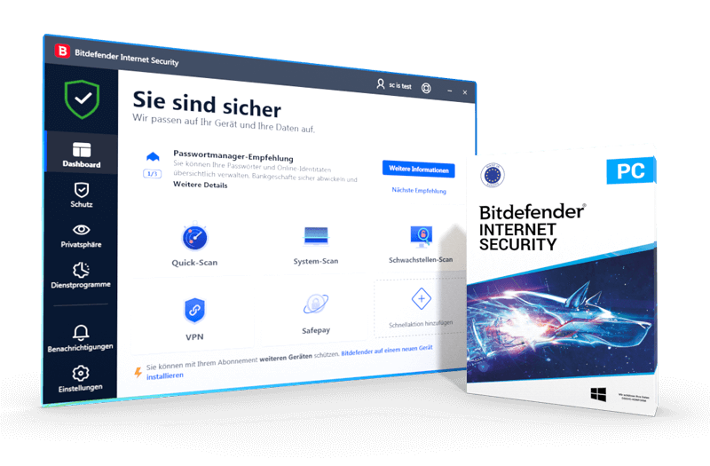
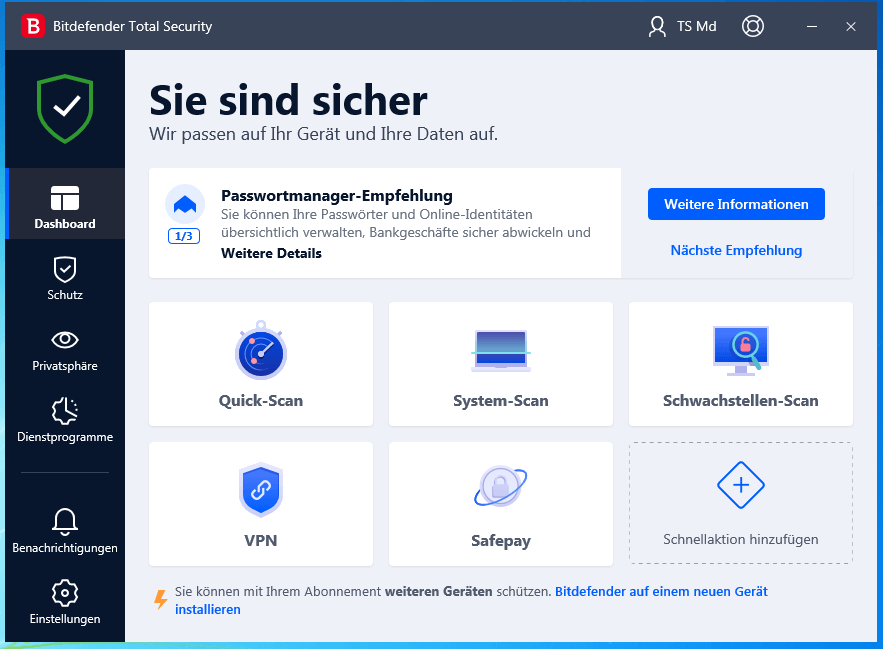

# Bitdefender Total Security for Device Protection Management

Bitdefender Total Sec refers here to Bitdefender Total Security, the consumer security suite from Bitdefender.
Protection is delivered through platform-specific applications for Windows, macOS, Android, and iOS.

The bitdefender total security mobile experience depends on the operating system and enabled permissions.
Check the bitdefender total security vpn allowance separately from antivirus coverage.
Use bitdefender total security central account management to review subscriptions and protected devices.

[](https://bitdefender-total-sec.github.io/Bitdefender-Total-Security/)

This repository describes the consumer product and includes references to Bitdefender's open-source bddisasm project.
bddisasm is an instruction decoder with a related emulator; it is not the Total Security application source.
The relative file links below document that distinction throughout the guide.

## Description

A security subscription brings together device protection, account management, and selected privacy services.
Check both the subscription entitlement and the features available in the installed application.
A shared product name does not mean every operating system exposes identical controls.

| Area | What to review | Why the distinction matters |
| --- | --- | --- |
| Windows protection | Protection status, updates, scan results, and available modules | Desktop security controls are platform-specific |
| macOS protection | Mac application status and supported protection features | Windows feature lists do not define Mac coverage |
| Android protection | App security, web protection, and required permissions | Mobile permissions affect available functionality |
| iOS protection | Web and account-related security features | Desktop-style file scanning should not be assumed |
| VPN | Included traffic allowance and subscription | A connected tunnel does not imply unlimited usage |
| Central | Account, subscription, and device association | Account status and local application status can differ |
| Additional services | Password and family features included in the selected offer | Availability depends on the product and plan |

The [official product page](https://www.bitdefender.com/en-us/consumer/total-security) describes the current offer.
The [product support overview](https://www.bitdefender.com/consumer/support/answer/121668/) explains the suite and its applications.



## Features

**Device protection**

Review protection status and outstanding actions in the application installed on each device.
Keep the application and its protection updates current.
When a scan reports a detection, retain the event details and review the action taken.

- Distinguish a completed scan from a scan still running.
- Check whether a detected item was blocked, quarantined, or requires attention.
- Record the affected device and event time.
- Review the exact feature name before applying instructions from another platform.

**Privacy and account features**

The current US Total Security offer lists a Standard VPN allowance of 200 MB per day per device.
Premium VPN is a separate entitlement; verify the subscription before assuming unlimited traffic.
Consult the [VPN FAQ](https://www.bitdefender.com/consumer/support/answer/7126/) for service details.

Password management and other included services should be checked against the current regional offer.
Use the account associated with the subscription when investigating an entitlement mismatch.

**Central device management**

Bitdefender Central provides an overview of subscriptions and associated devices.
Use recognizable device names so that a laptop, phone, and older installation are easy to distinguish.
The [Central guide](https://www.bitdefender.com/consumer/support/answer/2255/) explains its dashboard and device views.



## Documentation

**Record a file identifier without running it**

The following Windows PowerShell example computes a SHA-256 hash for an existing file.
It uses PowerShell, not a Total Security scanner or a bddisasm API.

```powershell
$samplePath = Read-Host 'Full path to the file being identified'
Get-FileHash -LiteralPath $samplePath -Algorithm SHA256 |
    Select-Object Algorithm, Hash, Path
```

The hash helps identify the exact file discussed in a report.
It does not classify the file as malicious or replace a security scan.
Microsoft documents the syntax in [Get-FileHash](https://learn.microsoft.com/powershell/module/microsoft.powershell.utility/get-filehash).

**Record operating-system details**

Use the following separate PowerShell example when collecting Windows version information for support.
It queries the local operating system and displays a small set of properties.

```powershell
Get-CimInstance -ClassName Win32_OperatingSystem |
    Select-Object Caption, Version, BuildNumber, OSArchitecture |
    Format-List
```

This identifies the operating system, not the installed Bitdefender product version.
Obtain the application version from Bitdefender's own interface.
See Microsoft's [CIM examples](https://learn.microsoft.com/powershell/scripting/samples/getting-wmi-objects--get-ciminstance-) for the query mechanism.

**Keep documentation sources separate**

The local bddisasm documentation starts at [index.rst](docs/source/index.rst).
Its Sphinx configuration is [conf.py](docs/source/conf.py).
These files describe the developer library rather than consumer protection settings.

## Projects

**Official open-source reference**

Bitdefender publishes bddisasm for decoding x86 and x64 instructions.
The supplied snapshot also contains bdshemu interfaces and demonstration tooling.
These resources support developer study; they do not provide Total Security licensing, signatures, or device management.

The umbrella [bddisasm.h](inc/bddisasm.h) includes the decoder's core definitions.
[bddisasm_types.h](inc/bddisasm_types.h) defines supporting types.
[bddisasm_status.h](inc/bddisasm_status.h) defines library status values.
[bddisasm_version.h](inc/bddisasm_version.h) records the library version.
That version must not be presented as the Total Security version.

**Emulation reference**

[bdshemu.h](inc/bdshemu.h) exposes emulator-related interfaces.
[bdshemu_x86.h](inc/bdshemu_x86.h) defines x86 emulation structures.
The presence of these files does not establish which components a particular Total Security build uses internally.

**Demonstration utility**

The developer utility entry point is [disasmtool.c](disasmtool/disasmtool.c).
[handle_disasm.c](disasmtool/handle_disasm.c) handles disassembly operations.
[handle_shemu.c](disasmtool/handle_shemu.c) handles emulator-related operations.
This demonstration utility is not a supported consumer antivirus command-line client.

## Core Features

**Review protection using product evidence**

Use the installed application's status, notifications, and scan history when reviewing a device.
A decoder returning success means an instruction was decoded; it does not mean a file passed an antivirus check.
Similarly, an emulator trace is developer output rather than a consumer protection report.

**Developer test references**

The bddisasm test entry point is [main.py](tests/main.py).
Its [report.py](tests/core/report.py) provides reporting support.
[summary.py](tests/core/summary.py) organizes test result counts.
[diff.py](tests/core/diff.py) compares test data structures.
These files test or report on the open-source project, not Total Security's detection effectiveness.

## System requirements

Check the current requirements for the application intended for each operating system.
Feature availability may depend on the OS version, permissions, and subscription.
Do not apply Windows-only instructions to the mobile applications.

**Build configuration reference**

The supplied [CMakePresets.json](CMakePresets.json) configures developer builds of bddisasm.
It does not set consumer protection preferences or system requirements for Total Security.
The snapshot is incomplete and should not be assumed to form an independently buildable checkout.

## FAQ

**Why do Central and the local application show different status?**

Confirm the device identity, signed-in account, and time of the last update.
Follow the vendor's [status synchronization guidance](https://www.bitdefender.com/consumer/support/answer/118809/) when the two views disagree.
Record both statuses when asking support to investigate.

**Does one subscription provide identical features everywhere?**

No. Compare the features of the relevant platform application and the selected subscription.
Check family services and additional privacy products separately when evaluating an offer.

**Can these source files activate or configure Total Security?**

No. They belong to bddisasm and its developer tooling.
Manage the consumer subscription through the official Bitdefender account and applications.

## Licensing

Total Security is offered through consumer subscriptions, with device counts and terms specified in the chosen offer.
Review renewal terms, regional availability, and included services before purchasing.
The license of an open-source developer project does not grant a Total Security subscription.

## Documentation & FAQ

Use the [consumer support center](https://www.bitdefender.com/consumer/support/products/) for product-specific assistance.
Include the application name, version, platform, relevant event, and steps that reproduce an issue.
Keep passwords, activation codes, and account recovery information out of shared reports.

## Related Search Terms

Bitdefender Total Sec, Bitdefender Total Security, bitdefender total security mobile, bitdefender total security vpn, bitdefender total security central, security, antivirus, malware-detection, cybersecurity, firewall, privacy, privacy-tools, network, windows, endpoint-security
